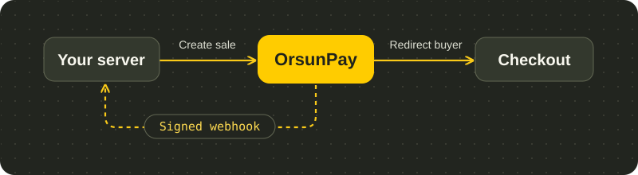

## Start with your checkout

<CardGroup cols={2}>
  <Card title="Accept your first payment" icon="terminal" href="/quickstart">
    Create a test sale, open hosted checkout and verify the event that lets you fulfil the order.
  </Card>
  <Card title="Share a payment link" icon="link" href="/payment-links">
    Send a buyer a checkout URL for a fixed amount. Choose a single-use link or reuse it across orders.
  </Card>
  <Card title="Choose a payment method" icon="wallet" href="/payment-methods">
    Find out which options a buyer can use and what your provider connection needs.
  </Card>
  <Card title="Work in the cabinet" icon="table-columns" href="/merchant-cabinet">
    Follow the merchant walkthrough or open the separate guide for backoffice operators.
  </Card>
</CardGroup>

## Build against the API

Send requests from your backend with the API key for your store and mode. An accepted sale gives you a transaction to track. Your order can be fulfilled when a verified update reports `SUCCESS` for the expected order, amount, currency and mode.

- [API overview](/api-overview) — choose the right operation and authentication scheme.
- [Webhooks](/webhooks) — verify the original request bytes and handle repeat deliveries.
- [Go live](/go-live) — move a tested integration onto your live provider connection.
