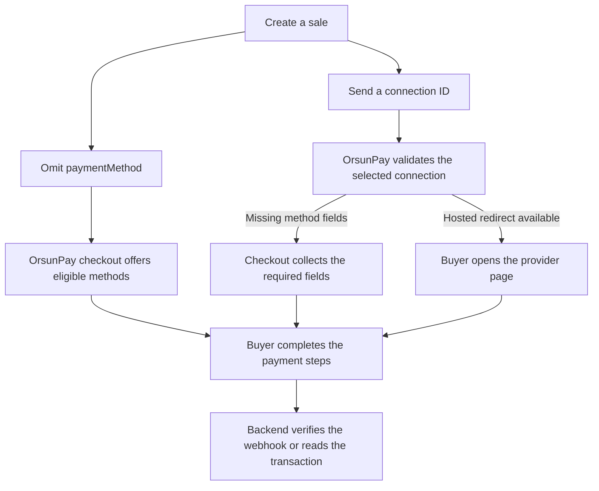

Use one of these two patterns with `POST /v1/payment/sale`. Both start on your backend with your merchant API key.



## Let the buyer choose

Send the [create-sale request](/create-sale) with both `paymentMethod` and `paymentMethodInput` omitted. Include any required buyer details under `customer`. With hosted checkout enabled, a successful response includes `paymentPageUrl`. Redirect the buyer to that URL unchanged. The buyer chooses from the eligible methods and provides any missing method fields.

## Select the connection on your server

Use the `cr_…` credential configuration ID for the method, provider, merchant and mode you intend to use. Store it in server-side configuration. Values such as `card`, `apple` and `revolut` describe a type or provider and cannot identify your merchant's connection.

For a Revolut hosted card sale, use the following JSON body with your sandbox merchant and connection IDs. The connector accepts an empty input object. Replace the example URLs with your own public HTTPS endpoints. Send a fresh `Idempotency-Key` for this sale and keep it when retrying the same request.

```json
{
  "merchantId": "mr_example",
  "orderId": "order_1042",
  "buyerId": "buyer_27",
  "amount": "24.50",
  "currency": "EUR",
  "paymentMethod": "cr_example_revolut_card",
  "paymentMethodInput": {},
  "successUrl": "https://merchant.example/orders/1042/success",
  "failureUrl": "https://merchant.example/orders/1042/failure",
  "returnUrl": "https://merchant.example/orders/1042",
  "callbackUrl": "https://merchant.example/webhooks/orsunpay"
}
```

Check the response body's `status` and `transaction.status`. For an accepted sale needing buyer action, follow `paymentPageUrl` when present, or `url` for a provider redirect. If the sale is already pending with no redirect, retain the transaction ID and read its status. Only mark the order paid after your backend verifies the successful transaction. [Transaction status](/transaction-status) · [Webhooks](/webhooks)

## If the method is missing

| Symptom | What to check |
| --- | --- |
| `PAYMENT_METHOD_REQUIRED` on a sale without a method | Confirm hosted checkout is enabled for your deployment or send an explicit connection ID. |
| `PAYMENT_METHOD_INPUT_WITHOUT_METHOD` | Omit method-specific fields until a connection has been chosen. |
| `NO_CREDENTIALS_FOR_MODE` | Check the merchant and whether your API key and active sale connection are both Test or both Live. |
| `NO_PAYMENT_METHODS` | Check amount limits, currency, country, routing conditions and merchant payment policy. |
| `CUSTOMER_CONTACT_REQUIRED` | Read the response’s `fields` list. Supply the missing buyer email or country on the sale. |
| A specific option is missing on the hosted page | Check that the provider accepts the buyer details on this sale. For Adyen, supply both email and country. For Brite, supply country. |

Test one sale with a fixed connection and another with buyer selection. For each, verify the expected method opens, the return page displays the order's current status, and a signed test webhook arrives at your test endpoint. [Testing in sandbox](/testing)
