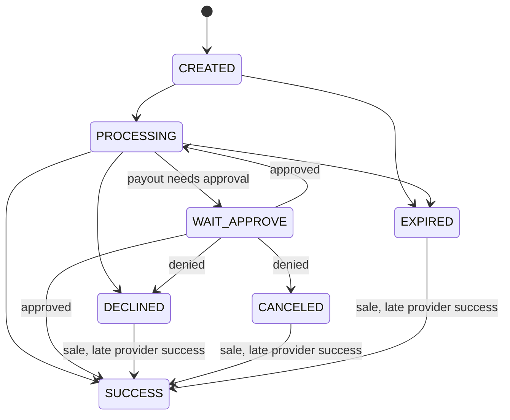

## Objects

| Object         | ID prefix | Created by                                                     |
| -------------- | --------- | -------------------------------------------------------------- |
| Transaction    | `tr_`     | `POST /v1/payment/sale` (action `SALE`) or `/payout` (`PAYOUT`) |
| Refund         | `rf_`     | `POST /v1/payment/{id}/refunds` on a successful sale           |
| Payment link   | `pl_`     | `POST /v1/payment-links` or the merchant cabinet               |
| Connection     | `cr_`     | Your provider account configuration; see [routing](/routing)   |

A **transaction** is one payment attempt with one provider connection. It carries your `orderId`,
the amount and currency you requested, and the `processingAmount` / `processingCurrency` actually
sent to the provider. The transaction schema also lists the actions `AUTHORIZE`, `REFUND` and
`CHARGEBACK`; the public create endpoints produce `SALE` and `PAYOUT`, and refunds are separate
`rf_` objects with their own [status model](/refunds).

`orderId` is unique per merchant and mode across sales and payouts. The prefix `pl_` is reserved
for payment links (`422 ORDER_ID_RESERVED`).

## Transaction statuses

| Status         | Meaning                                                                       | Final |
| -------------- | ----------------------------------------------------------------------------- | ----- |
| `CREATED`      | Created; the buyer has not completed the payment yet                          | No    |
| `PROCESSING`   | Sent to the provider or waiting for its result                                | No    |
| `WAIT_APPROVE` | A payout waiting for approval or denial                                       | No    |
| `SUCCESS`      | The provider confirmed the payment                                            | Yes   |
| `DECLINED`     | The provider or OrsunPay rejected it                                          | Yes*  |
| `CANCELED`     | Canceled, for example a denied payout                                         | Yes*  |
| `EXPIRED`      | Not completed in time                                                         | Yes*  |

\* Completed with a negative result. For a **sale**, a later `SUCCESS` reported by the provider
still replaces it, because the provider reports money that was actually taken. Only `SUCCESS` is
absorbing.

The diagram shows the common paths; not every provider uses every state. Rules that hold for all:

- **Fulfil only on `SUCCESS`.** Treat `DECLINED`, `CANCELED` and `EXPIRED` as the current
  negative result, not as an absorbing state: for a sale, keep accepting verified webhooks and
  apply a later `SUCCESS` (fulfil the order, or refund it if you have already replaced it).
- `PROCESSING` can last. With `errorCode: PSP_OUTCOME_UNKNOWN` the provider's answer was not
  received; keep the order pending and never resubmit it as a new payment.
- An `errorCode` alone is not a final state. For example, an Adyen session attempt refused with
  `ADYEN_REFUSED` keeps the transaction `PROCESSING` while the buyer may retry in the same session.
- A sale still `CREATED` 48 hours after creation becomes `EXPIRED` (default; your deployment can
  configure a different period). A provider that reports expiry itself can expire it earlier.
- Existing transaction modes never change: a test transaction stays a test transaction.

## Where statuses come from

Status changes are written together with an outbox event in one database transaction, so every
change that notifies you produces a [`transaction.updated` webhook](/webhook-events). You can also
read the stored state at any time with [`GET /v1/transactions/{id}`](/transaction-status); reads
never contact the provider.

## Money

All money fields are decimal strings in major units of their currency. See
[idempotency, money and versioning](/idempotency#money-format).
